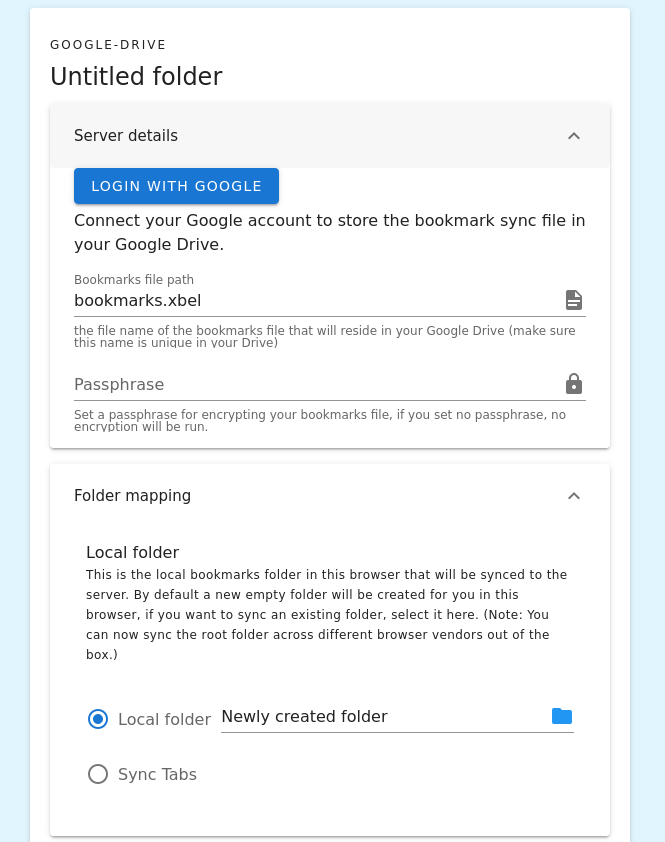

1. Create a new profile in the Floccus panel
2. Select Google Drive as your sync method
3. The following screen shows the profile settings.
4. First you will need to connect floccus with your Google account. After clicking “Login with Google”, you will need to sign in and grant floccus access to your Google Drive.
5. The next option allows you to specify the name of your bookmarks file in your Drive storage. Only enter the file name, not a full path, and make sure the name is unique in your Drive. By default floccus will place a file called bookmarks.xbel in your topmost folder.
6. If you’d like to encrypt your data before storing it in your Drive, you can set a passphrase here. If you don’t enter anything, it won’t be encrypted.
7. Finally, you can choose which bookmarks folder to sync to that file. Click on the folder icon to select a folder in your bookmarks. You will need to pick a folder before you can continue, and it’s a good idea to choose a dedicated folder to avoid syncing something that you don’t want synced. 
8. Make sure to disable your native browser bookmark sync service, because it is likely incompatible with floccus. (This can cause frequent duplication of bookmarks.)
