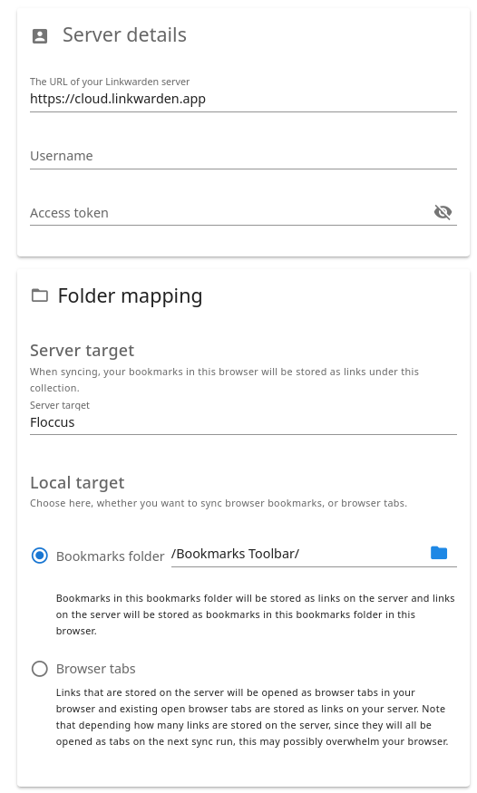

1. Create a new profile in the Floccus panel
2. Select Linkwarden as your sync method
3. Optionally set a name for your new profile.
4. The following screen shows the connection settings.
5. First you will need to enter your Linkwarden URL. This should be the root URL of your Linkwarden server, e.g. https://cloud.linkwarden.app/ for the publicly hosted instance by the linkwarden devs. The URL should end with a slash.
6. Then enter your username and an access token. Entering your account password will not work, instead you have to generate a specific access token in the linkwarden settings for floccus.
7. Enter the name of a collection to sync to. All your bookmarks as well as any folders you have will be created under this collection.
8. Finally, you can choose which bookmarks folder to sync to that collection. Click on the folder icon to select a folder in your bookmarks. You will need to pick a folder before you can continue, and it’s a good idea to choose a dedicated folder to avoid syncing something that you don’t want synced. 
9. Make sure to disable your native browser bookmark sync service, because it is likely incompatible with floccus. (This can cause frequent duplication of bookmarks.)
