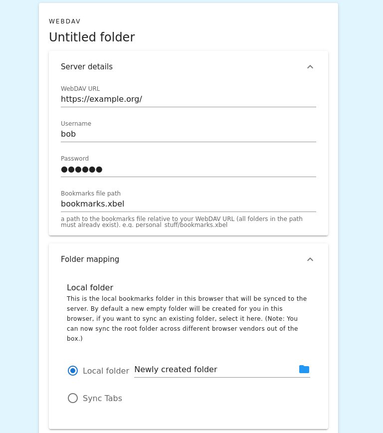

1. Create a new profile in the Floccus panel
2. Select XBEL in WebDAV as your sync method
3. The following screen shows the profile settings.
4. First you will need to enter your WebDAV URL. This should be the root URL of your WebDAV server, e.g. https://webdav.provider.com. The URL should end with a slash. Here’s [a list of the URLs for the most common public providers](https://community.cryptomator.org/t/webdav-urls-of-common-cloud-storage-services/75).
5. Then enter your username and password.
6. If you’d like to encrypt your data before storing it on the server, you can set a passphrase here. If you don’t enter anything, it won’t be encrypted.
7. Finally, you can choose which bookmarks folder to sync to that file. Click on the folder icon to select a folder in your bookmarks. You will need to pick a folder before you can continue, and it’s a good idea to choose a dedicated folder to avoid syncing something that you don’t want synced. 
   
8. Make sure to disable your native browser bookmark sync service, because it is likely incompatible with floccus
